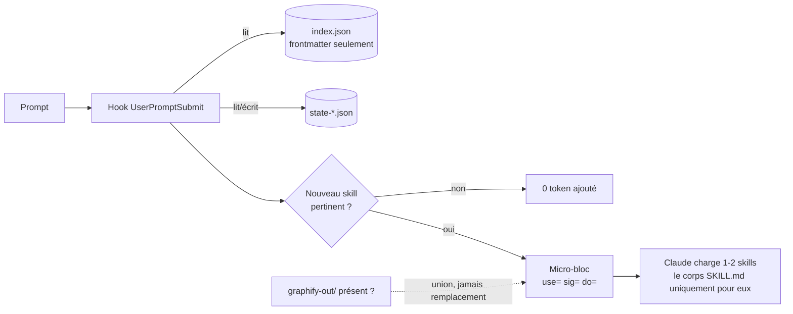
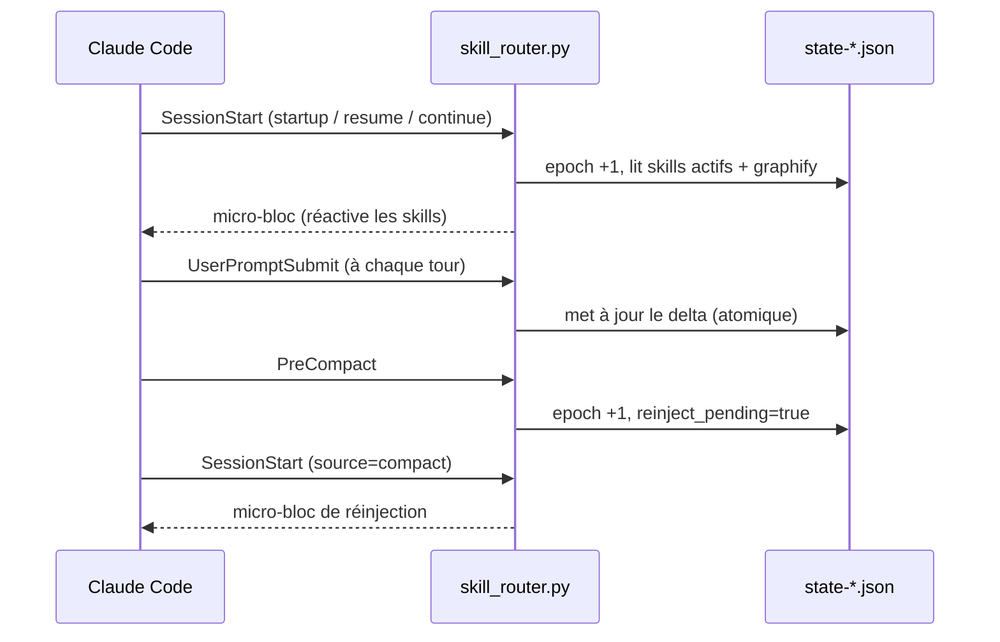

# skills-auto-use-best-skills

Un routeur de skills **silencieux** pour Claude Code. Il choisit les bons skills à chaque demande, sans te poser de question, sans interrompre ce qui tourne, et pour presque zéro token.

- **Toujours actif** via 3 hooks (`SessionStart`, `UserPromptSubmit`, `PreCompact`).
- **Invocable** à la main : `/skills-auto-use-best-skills`.
- **Python 3 standard uniquement.** Linux, macOS, Windows. Aucune dépendance.

> ⚠️ **Tu as installé la v0.1.0 ? Mets à jour.** Elle permettait à un dépôt piégé d'injecter du texte dans le contexte de Claude (voir [Sécurité](#sécurité)). Il n'y a **pas de mise à jour automatique**. Dans ton dossier cloné :
> `git pull`, puis `./install.sh` (ou `.\install.ps1` sous Windows), puis ouvre une nouvelle session.

## Installation (une commande)

```bash
# Linux / macOS / Git Bash
git clone https://github.com/isma212m/skills-auto-use-best-skills && cd skills-auto-use-best-skills && ./install.sh
```

```powershell
# Windows PowerShell
git clone https://github.com/isma212m/skills-auto-use-best-skills; cd skills-auto-use-best-skills; .\install.ps1
```

L'installateur est idempotent (tu peux le relancer). Il copie le skill dans `~/.claude/skills/`, fusionne les hooks dans `~/.claude/settings.json` et ajoute un bloc de 6 lignes à `~/.claude/CLAUDE.md`. Un backup `.bak` est créé avant chaque modification. Désinstallation : `./install.sh --uninstall` (ou `.\install.ps1 -Uninstall`).

Ouvre ensuite une nouvelle session Claude Code.

## Comment ça marche



### Deux niveaux pour économiser les tokens

| Niveau | Contenu | Coût en contexte |
|---|---|---|
| 1. Index en cache | `name`, `description` condensée, mots-clés. Jamais le corps des `SKILL.md`. Re-parse seulement si le `mtime` change. | 0 (reste sur disque) |
| 2. Chargement sélectif | Corps complet des 1-2 skills retenus (3 avec `graphify`). Pas de rechargement d'un skill déjà présent dans le contexte. | Un micro-bloc quand un skill doit être chargé, rien sinon |

Les hooks n'ajoutent rien au contexte quand rien ne change. Au démarrage d'une session, un seul bloc rappelle les skills actifs. La liste complète des skills n'est jamais injectée.

Sources indexées : `~/.claude/skills/` et les skills des plugins activés (marketplace et plugins synchronisés).

### Persistance : redémarrage, `--resume`, compaction



`context_epoch` compte les « vies » du contexte. Un skill n'est signalé que si son `loaded_epoch` diffère de l'epoch courante : pas de boucle de réinjection, mais rien n'est perdu après redémarrage ou compaction. L'état est écrit de façon atomique (`os.replace`).

### Zéro interruption

- **Silence** : aucune confirmation. Une ligne de signature (`[skills: graphify + pdf]`) n'apparaît que quand l'ensemble de skills change.
- **Tâche en cours** : un skill choisi reste « en cours » 10 minutes. Les messages de continuation (`ok`, `continue`, `suite`…) ne changent rien. Pour un pipeline long, `lock <skill>` le protège de toute éviction.
- **Cohabitation** : les skills s'additionnent (plafond : 2 métier + `graphify`) ; aucun n'en écrase un autre.
- **Anti-récursion** : le routeur s'exclut de l'index et ignore `/skills-auto-use-best-skills`.

### Avec Graphify

Si `graphify-out/` existe, si tu écris `/graphify`, ou si ta demande parle d'architecture ou de dépendances, `graphify` est ajouté comme couche de contexte structurel **en plus** du ou des skills métier. `graphify_active` est resynchronisé à chaque session.

## Commandes

| Commande | Effet |
|---|---|
| `/skills-auto-use-best-skills` | Diagnostic : skills indexés, actifs, état graphify, verrou, budget tokens estimé |
| `/skills-auto-use-best-skills pin <skill>` | Épingle un skill (rappelé à chaque session du projet) |
| `/skills-auto-use-best-skills unpin <skill>` | Libère le skill |
| `/skills-auto-use-best-skills reset` | Remet l'état à zéro |
| `lock <skill>` / `unlock <skill>` | Protège un pipeline multi-étapes en cours (utilisé par Claude) |

Fichiers : `~/.claude/skill-router/index.json` et `~/.claude/skill-router/state-<hash du dossier>.json`.

## Sécurité

Un hook écrit dans le contexte de Claude : c'est une surface d'**injection de prompt**.

- Le routeur ne lit **aucun fichier du projet ouvert** (ni skills, ni index, ni état). Il vérifie seulement si le dossier `graphify-out/` existe. Un dépôt cloné ne peut donc rien injecter par le routeur.
- La sortie ne contient que des **noms de skills validés** (lettres, chiffres, `_ . -`, un `:` pour les plugins) : pas de description, pas de chemin.
- Les skills offensifs / sécurité installés dans `~/.claude/skills/` ne sont proposés que si la demande parle de sécurité ou cite leur nom.
- Le texte de tes demandes n'est ni enregistré ni envoyé : aucun accès réseau.
- Limite : les skills et plugins que **tu** installes sont considérés comme fiables. Lis un skill avant de l'installer.

**Mise à jour depuis la v0.1.0 (important).** La v0.1.0 lisait l'index et l'état dans le dossier `.claude/` du projet : un dépôt piégé pouvait injecter du texte dans le contexte. Relance l'installateur. Les anciens fichiers `skills-index.json` et `active-skills-state.json` ne sont plus lus.

## Limites

- Le routage est lexical (mots-clés issus des descriptions, petite table de traduction FR→EN), pas sémantique. Il préfère ne rien proposer plutôt que proposer un hors-sujet : il rate donc des skills utiles. Claude garde son propre choix de skills.
- Les skills propres à un projet (`.claude/skills/`) ne sont pas routés, par sécurité. Claude Code les voit toujours.
- Un nouveau skill est vu à la session suivante (l'index est resynchronisé à `SessionStart`) ; `skill_router.py sync` le force.
- Le temps de calcul du script est de quelques millisecondes ; le démarrage de Python (surtout sous Windows) ajoute 50 à 300 ms par hook.
- Les hooks injectent du contexte ; Claude décide ensuite de charger le skill. Le routeur n'a aucun moyen de l'y forcer.

## Tests

```bash
python -m unittest discover -s tests
```

## Transparence sur l'IA

Ce projet a été conçu et écrit avec l'aide de Claude (IA d'Anthropic), puis relu et testé par son auteur.

## Licence

MIT, voir [LICENSE](LICENSE).
